# Quick How-To Guide: Adding & Using ApexGuard Agent Skills

[](https://www.skills.sh/masaner/apex-guard)

This guide walks you through installing ApexGuard's **12 AI Agent Skills** ([skills.sh/masaner/apex-guard](https://www.skills.sh/masaner/apex-guard)) in **30 seconds** and using the built-in **5-Stage Spec-Driven Workflow (`Propose → Explore → Apply → Verify → Archive`)** to refactor or build Salesforce code safely with zero hallucinations.

* **Live skills.sh Catalog:** [skills.sh/masaner/apex-guard](https://www.skills.sh/masaner/apex-guard)
* **Antigravity Platform Directory:** [skills.sh/agent/antigravity](https://www.skills.sh/agent/antigravity)
* **Specs Workspace Folder:** [`specs/`](../specs/README.md) (`specs/active/` & `specs/archived/`)

---

## Step 1: Add the Skills to Your AI Coding Agent

Run one command inside any Salesforce DX workspace (compatible with **Antigravity**, Claude Code, Cursor, GitHub Copilot, Codex, Gemini CLI, and other `skills.sh` agents):

```bash
# Install all 12 ApexGuard skills into your current project (./.agents/skills/)
npx skills add masaner/apex-guard
```

### Useful Options

```bash
# Install globally for Antigravity across every project on your machine (~/.agents/skills/)
npx skills add masaner/apex-guard -g --agent antigravity --skill '*' -y

# Preview all available skills without installing
npx skills add masaner/apex-guard --list

# Install only the 5 Spec-Driven Workflow skills
npx skills add masaner/apex-guard --skill apex-guard-propose apex-guard-explore apex-guard-apply apex-guard-verify apex-guard-archive

# Check installed skills / pull updates later
npx skills list
npx skills update
```

> **Tip for Antigravity Users:** After running `npx skills add masaner/apex-guard`, start a new Antigravity session in your workspace so Antigravity loads the newly installed skills automatically.

---

## Step 2: How the 5-Stage Spec-Driven Workflow Works (`specs/`)

When you ask your AI agent to introduce `ApexGuard` across an existing Apex class, Trigger, LWC controller, Flow, or Nebula Logger setup, ApexGuard uses a structured **5-stage pipeline** backed by clean Markdown spec files inside `specs/`:

```mermaid
flowchart LR
    U["User Intent"] --> S1["1. apex-guard-propose"]
    S1 -->|"Creates specs/active/<session>/01-proposal.md"| QA1["Clarifying Q&A (1+ rounds)"]
    QA1 -->|"User types: continue / next"| S2["2. apex-guard-explore"]
    S2 -->|"Zero-hallucination audit + style fingerprint -> 02-exploration.md"| QA2["Confirm Plan & Technical Q&A"]
    QA2 -->|"User types: continue / next"| S3["3. apex-guard-apply"]
    S3 -->|"Executes steps 1-by-1 in codebase style -> 03-apply.md"| S4["4. apex-guard-verify"]
    S4 -->|"Checks all goals, Prettier & Apex tests -> 04-verification.md"| Gate{"PASS?"}
    Gate -->|"Needs fix"| S3
    Gate -->|"User types: archive / continue"| S5["5. apex-guard-archive"]
    S5 -->|"Synthesizes specs/archived/<session>.md & cleans active/"| Done["Permanent Knowledge Record"]
```



### Active vs. Archived `specs/` Structure

```text
specs/
├── active/
│   └── 2026-11-17-0930-order-service-guards/   # Created automatically during Stage 1 (Propose)
│       ├── 01-proposal.md                      # Intent, goals, scope boundaries & Q&A answers
│       ├── 02-exploration.md                   # Verified files/lines, codebase style & ordered checklist
│       ├── 03-apply.md                         # Exact changes applied, spacing notes & deploy output
│       └── 04-verification.md                  # Full traceability matrix & Apex test evidence
└── archived/
    └── 2026-11-17-0930-order-service-guards.md # Consolidated Stage 5 archive for future AI agents
```

### What Each Workflow Skill Does

| Stage | Skill | What It Does | How It Advances |
| :--- | :--- | :--- | :--- |
| **1. Propose** | [`apex-guard-propose`](../skills/apex-guard-propose/SKILL.md) | Listens to your intent, creates `specs/active/<YYYY-MM-DD-HHmm>-<slug>/01-proposal.md`, and runs **1 or more rounds of clarifying questions** so assumptions are never guessed. | Answer questions; reply **`continue`** or **`next`** to auto-launch **Explore**. |
| **2. Explore** | [`apex-guard-explore`](../skills/apex-guard-explore/SKILL.md) | Performs a **zero-hallucination** read-only audit of every relevant class, Trigger, LWC, and org config; captures exact indentation, spacing, newline style, sharing, and test conventions; writes an ordered checklist in `02-exploration.md`. | Review & answer any technical questions; reply **`continue`** or **`next`** to auto-launch **Apply**. |
| **3. Apply** | [`apex-guard-apply`](../skills/apex-guard-apply/SKILL.md) | Executes every checklist item from `02-exploration.md` **sequentially, one by one**, matching the existing codebase/org style cleanly and recording exact line edits & command outputs in `03-apply.md`. | Automatically transitions to **Verify** once all checklist steps finish (or reply **`continue`** / **`verify`**). |
| **4. Verify** | [`apex-guard-verify`](../skills/apex-guard-verify/SKILL.md) | Cross-checks every Proposal goal and Exploration step against the edited code on disk, runs Prettier/CI checks and `sf apex run test`, and writes the Traceability Matrix in `04-verification.md`. | If all checks `PASS`, reply **`archive`** (or **`continue`**) to run **Archive**. |
| **5. Archive** | [`apex-guard-archive`](../skills/apex-guard-archive/SKILL.md) | Consolidates `01-` through `04-` into **one clean file** at `specs/archived/<YYYY-MM-DD-HHmm>-<slug>.md` (so future AI agents immediately have 100% of the know-how), deletes the temporary `specs/active/<session>/` folder, and updates [`specs/README.md`](../specs/README.md). | Spec session is cleanly archived and ready for future reference. |

---

## Step 3: Example End-to-End Prompt Flow

You only initiate Stage 1—after each review/Q&A checkpoint, typing **`continue`** (or **`archive`** at the end) moves seamlessly from skill to skill:

```text
You:   "Use apex-guard-propose: refactor OrderSubmissionService and its LWC controller
        to eliminate nested if/else checks, enforce running-user update FLS, and wire Nebula Logger."

Agent: [Creates specs/active/<timestamp>-order-submission-guards/01-proposal.md]
       Asks Round 1 clarifying questions (e.g., custom exception vs GuardException, target test suite).

You:   "1. Keep standard GuardException (auto AuraHandledException in LWC).
        2. Check Order.EffectiveDate and Order.Status update FLS before DML.
        continue"

Agent: [Updates 01-proposal.md Status -> CONFIRMED, auto-runs apex-guard-explore]
       Reads your classes & Prettier/newline conventions with zero hallucinations,
       writes 02-exploration.md with an ordered step-by-step checklist, and asks confirmation.

You:   "Looks accurate — continue"

Agent: [Marks 02-exploration.md CONFIRMED, auto-runs apex-guard-apply]
       Applies every checklist item 1-by-1 matching your exact spacing/sharing rules,
       writes 03-apply.md, then auto-runs apex-guard-verify.
       Runs Prettier & Apex unit tests, writes 04-verification.md (Overall Result: PASS),
       and asks: "Reply 'archive' to consolidate into specs/archived/ and clean up active/."

You:   "archive"

Agent: [Runs apex-guard-archive]
       Creates specs/archived/<timestamp>-order-submission-guards.md, updates specs/README.md,
       and removes specs/active/<timestamp>-order-submission-guards/.
```

---

## Step 4: Quick Cheat-Sheet for the 7 Domain Skills

When you don't need a full multi-stage `specs/` workflow (or alongside `Apply`/`Explore`), invoke or ask directly around any of the 7 domain skills:

| Task | Skill | Prompt Idea |
| :--- | :--- | :--- |
| Install package (`04td2000000WiM5AAK`) or deploy source | [`apex-guard-install`](../skills/apex-guard-install/SKILL.md) | *"Install ApexGuard using the Released Unlocked Package and run the Execute Anonymous smoke test."* |
| Refactor Services, LWC controllers, REST APIs | [`apex-guard-usage`](../skills/apex-guard-usage/SKILL.md) | *"Replace these nested checks with pass-through `Guard.*` calls and `Guard.forLwc()`."* |
| Validate records in Triggers / bulk DML | [`apex-guard-triggers-and-bulk-dml`](../skills/apex-guard-triggers-and-bulk-dml/SKILL.md) | *"Convert this Opportunity trigger validation loop to `Guard.onRecord(opp)` without breaking partial DML."* |
| Configure Flow or Agentforce validation | [`apex-guard-flows-and-agentforce`](../skills/apex-guard-flows-and-agentforce/SKILL.md) | *"Set up `GuardFlowAction` with `throwOnFailure = false` for Screen Flow Decision branching."* |
| Wire **Nebula Logger** or custom exceptions | [`apex-guard-extensibility-and-logging`](../skills/apex-guard-extensibility-and-logging/SKILL.md) | *"Implement `IGuardFailureHandler` for Nebula Logger so failures publish before rollback."* |
| Write `@IsTest` coverage & `System.runAs` tests | [`apex-guard-testing`](../skills/apex-guard-testing/SKILL.md) | *"Add locale-safe `System.runAs` and `Quiddity.AURA` unit tests with `Guard.resetContext()`."* |
| Review security, `isSet()`, CRUD/FLS & limits | [`apex-guard-security-and-best-practices`](../skills/apex-guard-security-and-best-practices/SKILL.md) | *"Audit our triggers and LWC controllers for `isSet()` safety and opt-in CRUD/FLS rules."* |

For deeper technical details on all CLI flags and CI validation, see [`docs/ai-agent-skills.md`](ai-agent-skills.md) and [`skills/README.md`](../skills/README.md).
